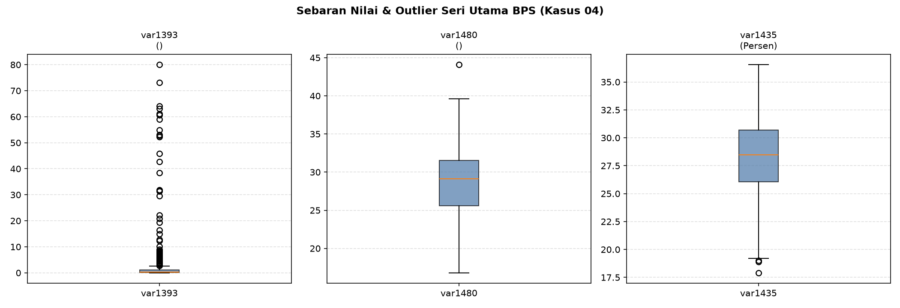
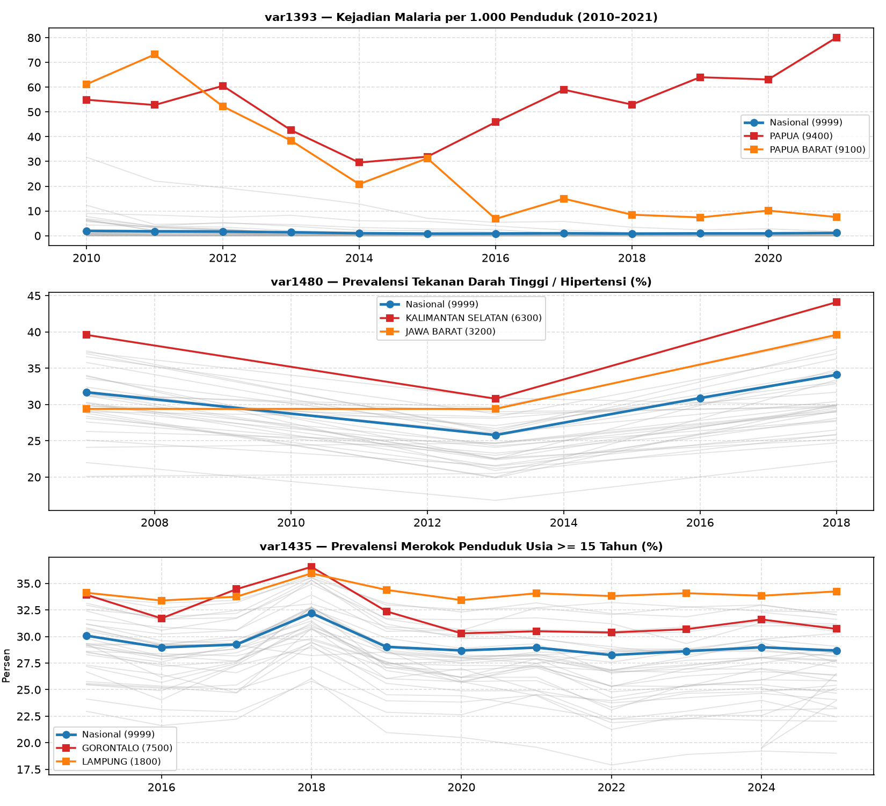

# Profil Statistik & Calon Anomali Seri Utama BPS (Kasus 04)

Dokumen ini merangkum hasil eksplorasi **Tahap 2** untuk tiga seri utama BPS pada Kasus 04: `var1393` (kejadian malaria), `var1480` (prevalensi tekanan darah tinggi), dan `var1435` (prevalensi merokok). Deteksi dilakukan untuk **menandai** calon anomali menggunakan metode **IQR** (`< Q1 - 1.5×IQR` atau `> Q3 + 1.5×IQR`) dan **z-score** (`|z| > 2.5`) tanpa menghapus maupun mengubah nilai asli.

## 1. Statistik Deskriptif per Seri

| seri_kode   | indikator                                        |   n_obs |   mean |    std |   min |     q1 |   median |     q3 |   iqr |   max |
|:------------|:-------------------------------------------------|--------:|-------:|-------:|------:|-------:|---------:|-------:|------:|------:|
| var1393     | Kejadian Malaria per 1.000 Penduduk (2010–2021)  |     832 |  3.368 | 10.997 |  0    |  0.04  |     0.23 |  1.113 | 1.073 | 80.05 |
| var1480     | Prevalensi Tekanan Darah Tinggi / Hipertensi (%) |     208 | 28.907 |  5.078 | 16.8  | 25.575 |    29.1  | 31.525 | 5.95  | 44.1  |
| var1435     | Prevalensi Merokok Penduduk Usia >= 15 Tahun (%) |     786 | 28.324 |  3.386 | 17.91 | 26.05  |    28.47 | 30.69  | 4.64  | 36.56 |

## 2. Visualisasi Sebaran & Deret Waktu

- **Boxplot Sebaran Nilai:** `reports/gambar/boxplot_seri_utama_bps.png`
- **Deret Waktu Nasional & Provinsi:** `reports/gambar/deret_waktu_seri_utama_bps.png`

## 3. Daftar Calon Anomali Terdeteksi

Total terdeteksi **140** observasi calon anomali (daftar lengkap juga tersimpan di `reports/calon-anomali-seri-utama.csv`).

| seri_kode   |   wilayah_kode | nama_wilayah         |   periode |   nilai | satuan   |   z_score | alasan                                                   |
|:------------|---------------:|:---------------------|----------:|--------:|:---------|----------:|:---------------------------------------------------------|
| var1393     |           1700 | BENGKULU             |      2010 |   6.86  |          |     0.317 | IQR atas (nilai 6.86 > 2.72)                             |
| var1393     |           1700 | BENGKULU             |      2010 |   6.86  |          |     0.317 | IQR atas (nilai 6.86 > 2.72)                             |
| var1393     |           1700 | BENGKULU             |      2011 |   3.892 |          |     0.048 | IQR atas (nilai 3.89 > 2.72)                             |
| var1393     |           1700 | BENGKULU             |      2011 |   3.892 |          |     0.048 | IQR atas (nilai 3.89 > 2.72)                             |
| var1393     |           1700 | BENGKULU             |      2012 |   5.319 |          |     0.177 | IQR atas (nilai 5.32 > 2.72)                             |
| var1393     |           1700 | BENGKULU             |      2012 |   5.319 |          |     0.177 | IQR atas (nilai 5.32 > 2.72)                             |
| var1393     |           1700 | BENGKULU             |      2013 |   3.89  |          |     0.047 | IQR atas (nilai 3.89 > 2.72)                             |
| var1393     |           1700 | BENGKULU             |      2013 |   3.89  |          |     0.047 | IQR atas (nilai 3.89 > 2.72)                             |
| var1393     |           1900 | KEP. BANGKA BELITUNG |      2010 |   7.77  |          |     0.4   | IQR atas (nilai 7.77 > 2.72)                             |
| var1393     |           1900 | KEP. BANGKA BELITUNG |      2010 |   7.77  |          |     0.4   | IQR atas (nilai 7.77 > 2.72)                             |
| var1393     |           1900 | KEP. BANGKA BELITUNG |      2011 |   3.665 |          |     0.027 | IQR atas (nilai 3.67 > 2.72)                             |
| var1393     |           1900 | KEP. BANGKA BELITUNG |      2011 |   3.665 |          |     0.027 | IQR atas (nilai 3.67 > 2.72)                             |
| var1393     |           2100 | KEP. RIAU            |      2010 |   6.59  |          |     0.293 | IQR atas (nilai 6.59 > 2.72)                             |
| var1393     |           2100 | KEP. RIAU            |      2010 |   6.59  |          |     0.293 | IQR atas (nilai 6.59 > 2.72)                             |
| var1393     |           5300 | NUSA TENGGARA TIMUR  |      2010 |  31.72  |          |     2.578 | IQR atas (nilai 31.72 > 2.72); z-score ekstrem (+2.58)   |
| var1393     |           5300 | NUSA TENGGARA TIMUR  |      2010 |  31.72  |          |     2.578 | IQR atas (nilai 31.72 > 2.72); z-score ekstrem (+2.58)   |
| var1393     |           5300 | NUSA TENGGARA TIMUR  |      2011 |  22.085 |          |     1.702 | IQR atas (nilai 22.09 > 2.72)                            |
| var1393     |           5300 | NUSA TENGGARA TIMUR  |      2011 |  22.085 |          |     1.702 | IQR atas (nilai 22.09 > 2.72)                            |
| var1393     |           5300 | NUSA TENGGARA TIMUR  |      2012 |  19.411 |          |     1.459 | IQR atas (nilai 19.41 > 2.72)                            |
| var1393     |           5300 | NUSA TENGGARA TIMUR  |      2012 |  19.411 |          |     1.459 | IQR atas (nilai 19.41 > 2.72)                            |
| var1393     |           5300 | NUSA TENGGARA TIMUR  |      2013 |  16.37  |          |     1.182 | IQR atas (nilai 16.37 > 2.72)                            |
| var1393     |           5300 | NUSA TENGGARA TIMUR  |      2013 |  16.37  |          |     1.182 | IQR atas (nilai 16.37 > 2.72)                            |
| var1393     |           5300 | NUSA TENGGARA TIMUR  |      2014 |  12.81  |          |     0.859 | IQR atas (nilai 12.81 > 2.72)                            |
| var1393     |           5300 | NUSA TENGGARA TIMUR  |      2014 |  12.81  |          |     0.859 | IQR atas (nilai 12.81 > 2.72)                            |
| var1393     |           5300 | NUSA TENGGARA TIMUR  |      2015 |   7.04  |          |     0.334 | IQR atas (nilai 7.04 > 2.72)                             |
| var1393     |           5300 | NUSA TENGGARA TIMUR  |      2015 |   7.04  |          |     0.334 | IQR atas (nilai 7.04 > 2.72)                             |
| var1393     |           5300 | NUSA TENGGARA TIMUR  |      2016 |   5.41  |          |     0.186 | IQR atas (nilai 5.41 > 2.72)                             |
| var1393     |           5300 | NUSA TENGGARA TIMUR  |      2016 |   5.41  |          |     0.186 | IQR atas (nilai 5.41 > 2.72)                             |
| var1393     |           5300 | NUSA TENGGARA TIMUR  |      2017 |   5.76  |          |     0.217 | IQR atas (nilai 5.76 > 2.72)                             |
| var1393     |           5300 | NUSA TENGGARA TIMUR  |      2017 |   5.76  |          |     0.217 | IQR atas (nilai 5.76 > 2.72)                             |
| var1393     |           5300 | NUSA TENGGARA TIMUR  |      2018 |   3.42  |          |     0.005 | IQR atas (nilai 3.42 > 2.72)                             |
| var1393     |           5300 | NUSA TENGGARA TIMUR  |      2018 |   3.42  |          |     0.005 | IQR atas (nilai 3.42 > 2.72)                             |
| var1393     |           5300 | NUSA TENGGARA TIMUR  |      2020 |   2.76  |          |    -0.055 | IQR atas (nilai 2.76 > 2.72)                             |
| var1393     |           5300 | NUSA TENGGARA TIMUR  |      2020 |   2.76  |          |    -0.055 | IQR atas (nilai 2.76 > 2.72)                             |
| var1393     |           6100 | KALIMANTAN BARAT     |      2010 |   6.18  |          |     0.256 | IQR atas (nilai 6.18 > 2.72)                             |
| var1393     |           6100 | KALIMANTAN BARAT     |      2010 |   6.18  |          |     0.256 | IQR atas (nilai 6.18 > 2.72)                             |
| var1393     |           6200 | KALIMANTAN TENGAH    |      2010 |   4.34  |          |     0.088 | IQR atas (nilai 4.34 > 2.72)                             |
| var1393     |           6200 | KALIMANTAN TENGAH    |      2010 |   4.34  |          |     0.088 | IQR atas (nilai 4.34 > 2.72)                             |
| var1393     |           6200 | KALIMANTAN TENGAH    |      2011 |   3.742 |          |     0.034 | IQR atas (nilai 3.74 > 2.72)                             |
| var1393     |           6200 | KALIMANTAN TENGAH    |      2011 |   3.742 |          |     0.034 | IQR atas (nilai 3.74 > 2.72)                             |
| var1393     |           6200 | KALIMANTAN TENGAH    |      2012 |   3.484 |          |     0.011 | IQR atas (nilai 3.48 > 2.72)                             |
| var1393     |           6200 | KALIMANTAN TENGAH    |      2012 |   3.484 |          |     0.011 | IQR atas (nilai 3.48 > 2.72)                             |
| var1393     |           7100 | SULAWESI UTARA       |      2010 |   6.11  |          |     0.249 | IQR atas (nilai 6.11 > 2.72)                             |
| var1393     |           7100 | SULAWESI UTARA       |      2010 |   6.11  |          |     0.249 | IQR atas (nilai 6.11 > 2.72)                             |
| var1393     |           7100 | SULAWESI UTARA       |      2011 |   3.215 |          |    -0.014 | IQR atas (nilai 3.21 > 2.72)                             |
| var1393     |           7100 | SULAWESI UTARA       |      2011 |   3.215 |          |    -0.014 | IQR atas (nilai 3.21 > 2.72)                             |
| var1393     |           7200 | SULAWESI TENGAH      |      2010 |   5.69  |          |     0.211 | IQR atas (nilai 5.69 > 2.72)                             |
| var1393     |           7200 | SULAWESI TENGAH      |      2010 |   5.69  |          |     0.211 | IQR atas (nilai 5.69 > 2.72)                             |
| var1393     |           7200 | SULAWESI TENGAH      |      2011 |   3.355 |          |    -0.001 | IQR atas (nilai 3.35 > 2.72)                             |
| var1393     |           7200 | SULAWESI TENGAH      |      2011 |   3.355 |          |    -0.001 | IQR atas (nilai 3.35 > 2.72)                             |
| var1393     |           8100 | MALUKU               |      2010 |   8.98  |          |     0.51  | IQR atas (nilai 8.98 > 2.72)                             |
| var1393     |           8100 | MALUKU               |      2010 |   8.98  |          |     0.51  | IQR atas (nilai 8.98 > 2.72)                             |
| var1393     |           8100 | MALUKU               |      2011 |   8.34  |          |     0.452 | IQR atas (nilai 8.34 > 2.72)                             |
| var1393     |           8100 | MALUKU               |      2011 |   8.34  |          |     0.452 | IQR atas (nilai 8.34 > 2.72)                             |
| var1393     |           8100 | MALUKU               |      2012 |   7.417 |          |     0.368 | IQR atas (nilai 7.42 > 2.72)                             |
| var1393     |           8100 | MALUKU               |      2012 |   7.417 |          |     0.368 | IQR atas (nilai 7.42 > 2.72)                             |
| var1393     |           8100 | MALUKU               |      2013 |   8.25  |          |     0.444 | IQR atas (nilai 8.25 > 2.72)                             |
| var1393     |           8100 | MALUKU               |      2013 |   8.25  |          |     0.444 | IQR atas (nilai 8.25 > 2.72)                             |
| var1393     |           8100 | MALUKU               |      2014 |   6     |          |     0.239 | IQR atas (nilai 6.00 > 2.72)                             |
| var1393     |           8100 | MALUKU               |      2014 |   6     |          |     0.239 | IQR atas (nilai 6.00 > 2.72)                             |
| var1393     |           8100 | MALUKU               |      2015 |   5.81  |          |     0.222 | IQR atas (nilai 5.81 > 2.72)                             |
| var1393     |           8100 | MALUKU               |      2015 |   5.81  |          |     0.222 | IQR atas (nilai 5.81 > 2.72)                             |
| var1393     |           8100 | MALUKU               |      2016 |   3.95  |          |     0.053 | IQR atas (nilai 3.95 > 2.72)                             |
| var1393     |           8100 | MALUKU               |      2016 |   3.95  |          |     0.053 | IQR atas (nilai 3.95 > 2.72)                             |
| var1393     |           8200 | MALUKU UTARA         |      2010 |  12.32  |          |     0.814 | IQR atas (nilai 12.32 > 2.72)                            |
| var1393     |           8200 | MALUKU UTARA         |      2010 |  12.32  |          |     0.814 | IQR atas (nilai 12.32 > 2.72)                            |
| var1393     |           8200 | MALUKU UTARA         |      2011 |   4.566 |          |     0.109 | IQR atas (nilai 4.57 > 2.72)                             |
| var1393     |           8200 | MALUKU UTARA         |      2011 |   4.566 |          |     0.109 | IQR atas (nilai 4.57 > 2.72)                             |
| var1393     |           8200 | MALUKU UTARA         |      2012 |   5.078 |          |     0.155 | IQR atas (nilai 5.08 > 2.72)                             |
| var1393     |           8200 | MALUKU UTARA         |      2012 |   5.078 |          |     0.155 | IQR atas (nilai 5.08 > 2.72)                             |
| var1393     |           8200 | MALUKU UTARA         |      2013 |   4.51  |          |     0.104 | IQR atas (nilai 4.51 > 2.72)                             |
| var1393     |           8200 | MALUKU UTARA         |      2013 |   4.51  |          |     0.104 | IQR atas (nilai 4.51 > 2.72)                             |
| var1393     |           8200 | MALUKU UTARA         |      2014 |   3.32  |          |    -0.004 | IQR atas (nilai 3.32 > 2.72)                             |
| var1393     |           8200 | MALUKU UTARA         |      2014 |   3.32  |          |    -0.004 | IQR atas (nilai 3.32 > 2.72)                             |
| var1393     |           8200 | MALUKU UTARA         |      2015 |   2.77  |          |    -0.054 | IQR atas (nilai 2.77 > 2.72)                             |
| var1393     |           8200 | MALUKU UTARA         |      2015 |   2.77  |          |    -0.054 | IQR atas (nilai 2.77 > 2.72)                             |
| var1393     |           9100 | PAPUA BARAT          |      2010 |  61.18  |          |     5.257 | IQR atas (nilai 61.18 > 2.72); z-score ekstrem (+5.26)   |
| var1393     |           9100 | PAPUA BARAT          |      2010 |  61.18  |          |     5.257 | IQR atas (nilai 61.18 > 2.72); z-score ekstrem (+5.26)   |
| var1393     |           9100 | PAPUA BARAT          |      2011 |  73.207 |          |     6.351 | IQR atas (nilai 73.21 > 2.72); z-score ekstrem (+6.35)   |
| var1393     |           9100 | PAPUA BARAT          |      2011 |  73.207 |          |     6.351 | IQR atas (nilai 73.21 > 2.72); z-score ekstrem (+6.35)   |
| var1393     |           9100 | PAPUA BARAT          |      2012 |  52.269 |          |     4.447 | IQR atas (nilai 52.27 > 2.72); z-score ekstrem (+4.45)   |
| var1393     |           9100 | PAPUA BARAT          |      2012 |  52.269 |          |     4.447 | IQR atas (nilai 52.27 > 2.72); z-score ekstrem (+4.45)   |
| var1393     |           9100 | PAPUA BARAT          |      2013 |  38.44  |          |     3.189 | IQR atas (nilai 38.44 > 2.72); z-score ekstrem (+3.19)   |
| var1393     |           9100 | PAPUA BARAT          |      2013 |  38.44  |          |     3.189 | IQR atas (nilai 38.44 > 2.72); z-score ekstrem (+3.19)   |
| var1393     |           9100 | PAPUA BARAT          |      2014 |  20.85  |          |     1.59  | IQR atas (nilai 20.85 > 2.72)                            |
| var1393     |           9100 | PAPUA BARAT          |      2014 |  20.85  |          |     1.59  | IQR atas (nilai 20.85 > 2.72)                            |
| var1393     |           9100 | PAPUA BARAT          |      2015 |  31.29  |          |     2.539 | IQR atas (nilai 31.29 > 2.72); z-score ekstrem (+2.54)   |
| var1393     |           9100 | PAPUA BARAT          |      2015 |  31.29  |          |     2.539 | IQR atas (nilai 31.29 > 2.72); z-score ekstrem (+2.54)   |
| var1393     |           9100 | PAPUA BARAT          |      2016 |   6.79  |          |     0.311 | IQR atas (nilai 6.79 > 2.72)                             |
| var1393     |           9100 | PAPUA BARAT          |      2016 |   6.79  |          |     0.311 | IQR atas (nilai 6.79 > 2.72)                             |
| var1393     |           9100 | PAPUA BARAT          |      2017 |  14.97  |          |     1.055 | IQR atas (nilai 14.97 > 2.72)                            |
| var1393     |           9100 | PAPUA BARAT          |      2017 |  14.97  |          |     1.055 | IQR atas (nilai 14.97 > 2.72)                            |
| var1393     |           9100 | PAPUA BARAT          |      2018 |   8.49  |          |     0.466 | IQR atas (nilai 8.49 > 2.72)                             |
| var1393     |           9100 | PAPUA BARAT          |      2018 |   8.49  |          |     0.466 | IQR atas (nilai 8.49 > 2.72)                             |
| var1393     |           9100 | PAPUA BARAT          |      2019 |   7.38  |          |     0.365 | IQR atas (nilai 7.38 > 2.72)                             |
| var1393     |           9100 | PAPUA BARAT          |      2019 |   7.38  |          |     0.365 | IQR atas (nilai 7.38 > 2.72)                             |
| var1393     |           9100 | PAPUA BARAT          |      2020 |  10.15  |          |     0.617 | IQR atas (nilai 10.15 > 2.72)                            |
| var1393     |           9100 | PAPUA BARAT          |      2020 |  10.15  |          |     0.617 | IQR atas (nilai 10.15 > 2.72)                            |
| var1393     |           9100 | PAPUA BARAT          |      2021 |   7.56  |          |     0.381 | IQR atas (nilai 7.56 > 2.72)                             |
| var1393     |           9100 | PAPUA BARAT          |      2021 |   7.56  |          |     0.381 | IQR atas (nilai 7.56 > 2.72)                             |
| var1393     |           9400 | PAPUA                |      2010 |  54.94  |          |     4.69  | IQR atas (nilai 54.94 > 2.72); z-score ekstrem (+4.69)   |
| var1393     |           9400 | PAPUA                |      2010 |  54.94  |          |     4.69  | IQR atas (nilai 54.94 > 2.72); z-score ekstrem (+4.69)   |
| var1393     |           9400 | PAPUA                |      2011 |  52.8   |          |     4.495 | IQR atas (nilai 52.80 > 2.72); z-score ekstrem (+4.49)   |
| var1393     |           9400 | PAPUA                |      2011 |  52.8   |          |     4.495 | IQR atas (nilai 52.80 > 2.72); z-score ekstrem (+4.49)   |
| var1393     |           9400 | PAPUA                |      2012 |  60.556 |          |     5.2   | IQR atas (nilai 60.56 > 2.72); z-score ekstrem (+5.20)   |
| var1393     |           9400 | PAPUA                |      2012 |  60.556 |          |     5.2   | IQR atas (nilai 60.56 > 2.72); z-score ekstrem (+5.20)   |
| var1393     |           9400 | PAPUA                |      2013 |  42.65  |          |     3.572 | IQR atas (nilai 42.65 > 2.72); z-score ekstrem (+3.57)   |
| var1393     |           9400 | PAPUA                |      2013 |  42.65  |          |     3.572 | IQR atas (nilai 42.65 > 2.72); z-score ekstrem (+3.57)   |
| var1393     |           9400 | PAPUA                |      2014 |  29.57  |          |     2.383 | IQR atas (nilai 29.57 > 2.72)                            |
| var1393     |           9400 | PAPUA                |      2014 |  29.57  |          |     2.383 | IQR atas (nilai 29.57 > 2.72)                            |
| var1393     |           9400 | PAPUA                |      2015 |  31.93  |          |     2.597 | IQR atas (nilai 31.93 > 2.72); z-score ekstrem (+2.60)   |
| var1393     |           9400 | PAPUA                |      2015 |  31.93  |          |     2.597 | IQR atas (nilai 31.93 > 2.72); z-score ekstrem (+2.60)   |
| var1393     |           9400 | PAPUA                |      2016 |  45.85  |          |     3.863 | IQR atas (nilai 45.85 > 2.72); z-score ekstrem (+3.86)   |
| var1393     |           9400 | PAPUA                |      2016 |  45.85  |          |     3.863 | IQR atas (nilai 45.85 > 2.72); z-score ekstrem (+3.86)   |
| var1393     |           9400 | PAPUA                |      2017 |  59     |          |     5.059 | IQR atas (nilai 59.00 > 2.72); z-score ekstrem (+5.06)   |
| var1393     |           9400 | PAPUA                |      2017 |  59     |          |     5.059 | IQR atas (nilai 59.00 > 2.72); z-score ekstrem (+5.06)   |
| var1393     |           9400 | PAPUA                |      2018 |  52.99  |          |     4.512 | IQR atas (nilai 52.99 > 2.72); z-score ekstrem (+4.51)   |
| var1393     |           9400 | PAPUA                |      2018 |  52.99  |          |     4.512 | IQR atas (nilai 52.99 > 2.72); z-score ekstrem (+4.51)   |
| var1393     |           9400 | PAPUA                |      2019 |  64.03  |          |     5.516 | IQR atas (nilai 64.03 > 2.72); z-score ekstrem (+5.52)   |
| var1393     |           9400 | PAPUA                |      2019 |  64.03  |          |     5.516 | IQR atas (nilai 64.03 > 2.72); z-score ekstrem (+5.52)   |
| var1393     |           9400 | PAPUA                |      2020 |  63.12  |          |     5.433 | IQR atas (nilai 63.12 > 2.72); z-score ekstrem (+5.43)   |
| var1393     |           9400 | PAPUA                |      2020 |  63.12  |          |     5.433 | IQR atas (nilai 63.12 > 2.72); z-score ekstrem (+5.43)   |
| var1393     |           9400 | PAPUA                |      2021 |  80.05  |          |     6.973 | IQR atas (nilai 80.05 > 2.72); z-score ekstrem (+6.97)   |
| var1393     |           9400 | PAPUA                |      2021 |  80.05  |          |     6.973 | IQR atas (nilai 80.05 > 2.72); z-score ekstrem (+6.97)   |
| var1435     |           5100 | BALI                 |      2021 |  19.58  | Persen   |    -2.582 | z-score ekstrem (-2.58)                                  |
| var1435     |           5100 | BALI                 |      2021 |  19.58  | Persen   |    -2.582 | z-score ekstrem (-2.58)                                  |
| var1435     |           5100 | BALI                 |      2022 |  17.91  | Persen   |    -3.075 | IQR bawah (nilai 17.91 < 19.09); z-score ekstrem (-3.08) |
| var1435     |           5100 | BALI                 |      2022 |  17.91  | Persen   |    -3.075 | IQR bawah (nilai 17.91 < 19.09); z-score ekstrem (-3.08) |
| var1435     |           5100 | BALI                 |      2023 |  18.9   | Persen   |    -2.783 | IQR bawah (nilai 18.90 < 19.09); z-score ekstrem (-2.78) |
| var1435     |           5100 | BALI                 |      2023 |  18.9   | Persen   |    -2.783 | IQR bawah (nilai 18.90 < 19.09); z-score ekstrem (-2.78) |
| var1435     |           5100 | BALI                 |      2024 |  19.22  | Persen   |    -2.689 | z-score ekstrem (-2.69)                                  |
| var1435     |           5100 | BALI                 |      2024 |  19.22  | Persen   |    -2.689 | z-score ekstrem (-2.69)                                  |
| var1435     |           5100 | BALI                 |      2025 |  19.02  | Persen   |    -2.748 | IQR bawah (nilai 19.02 < 19.09); z-score ekstrem (-2.75) |
| var1435     |           5100 | BALI                 |      2025 |  19.02  | Persen   |    -2.748 | IQR bawah (nilai 19.02 < 19.09); z-score ekstrem (-2.75) |
| var1435     |           9600 | PAPUA TENGAH         |      2024 |  19.48  | Persen   |    -2.612 | z-score ekstrem (-2.61)                                  |
| var1435     |           9600 | PAPUA TENGAH         |      2024 |  19.48  | Persen   |    -2.612 | z-score ekstrem (-2.61)                                  |
| var1435     |           9700 | PAPUA PEGUNUNGAN     |      2024 |  19.54  | Persen   |    -2.594 | z-score ekstrem (-2.59)                                  |
| var1435     |           9700 | PAPUA PEGUNUNGAN     |      2024 |  19.54  | Persen   |    -2.594 | z-score ekstrem (-2.59)                                  |
| var1480     |           6300 | KALIMANTAN SELATAN   |      2018 |  44.1   |          |     2.992 | IQR atas (nilai 44.10 > 40.45); z-score ekstrem (+2.99)  |
| var1480     |           6300 | KALIMANTAN SELATAN   |      2018 |  44.1   |          |     2.992 | IQR atas (nilai 44.10 > 40.45); z-score ekstrem (+2.99)  |

## 4. Ringkasan Statistik Deskriptif per Provinsi (Semua Seri Utama)

| seri_kode   |   wilayah_kode | nama_wilayah         |   n_tahun |   mean |    std |    min |     q1 |   median |     q3 |    max |
|:------------|---------------:|:---------------------|----------:|-------:|-------:|-------:|-------:|---------:|-------:|-------:|
| var1393     |           1100 | ACEH                 |        24 |  0.251 |  0.299 |  0.02  |  0.048 |    0.07  |  0.439 |  0.88  |
| var1393     |           1200 | SUMATERA UTARA       |        24 |  0.497 |  0.409 |  0.07  |  0.15  |    0.38  |  0.844 |  1.3   |
| var1393     |           1300 | SUMATERA BARAT       |        24 |  0.142 |  0.106 |  0.01  |  0.082 |    0.11  |  0.197 |  0.38  |
| var1393     |           1400 | RIAU                 |        24 |  0.191 |  0.267 |  0.01  |  0.03  |    0.13  |  0.209 |  1.02  |
| var1393     |           1500 | JAMBI                |        24 |  0.604 |  0.683 |  0.01  |  0.042 |    0.305 |  1.085 |  2.18  |
| var1393     |           1600 | SUMATERA SELATAN     |        24 |  0.314 |  0.474 |  0     |  0.078 |    0.21  |  0.302 |  1.8   |
| var1393     |           1700 | BENGKULU             |        24 |  2.199 |  2.262 |  0     |  0.132 |    1.74  |  3.891 |  6.86  |
| var1393     |           1800 | LAMPUNG              |        24 |  0.348 |  0.182 |  0.05  |  0.179 |    0.39  |  0.498 |  0.55  |
| var1393     |           1900 | KEP. BANGKA BELITUNG |        24 |  1.495 |  2.24  |  0.07  |  0.105 |    0.51  |  1.625 |  7.77  |
| var1393     |           2100 | KEP. RIAU            |        24 |  1.086 |  1.859 |  0.02  |  0.105 |    0.355 |  0.845 |  6.59  |
| var1393     |           3100 | DKI JAKARTA          |        24 |  0.005 |  0.005 |  0     |  0     |    0.005 |  0.01  |  0.01  |
| var1393     |           3200 | JAWA BARAT           |        24 |  0.042 |  0.12  |  0     |  0     |    0.01  |  0.01  |  0.43  |
| var1393     |           3300 | JAWA TENGAH          |        24 |  0.034 |  0.026 |  0.006 |  0.018 |    0.03  |  0.042 |  0.1   |
| var1393     |           3400 | DI YOGYAKARTA        |        24 |  0.018 |  0.016 |  0     |  0.008 |    0.015 |  0.022 |  0.059 |
| var1393     |           3500 | JAWA TIMUR           |        24 |  0.016 |  0.027 |  0     |  0.001 |    0.01  |  0.012 |  0.1   |
| var1393     |           3600 | BANTEN               |        24 |  0.004 |  0.007 |  0     |  0     |    0     |  0.008 |  0.021 |
| var1393     |           5100 | BALI                 |        24 |  0.007 |  0.01  |  0     |  0     |    0.001 |  0.01  |  0.03  |
| var1393     |           5200 | NUSA TENGGARA BARAT  |        24 |  0.554 |  0.555 |  0.05  |  0.18  |    0.38  |  0.79  |  2.08  |
| var1393     |           5300 | NUSA TENGGARA TIMUR  |        24 | 10.904 |  9.399 |  1.69  |  3.255 |    6.4   | 17.13  | 31.72  |
| var1393     |           6100 | KALIMANTAN BARAT     |        24 |  0.825 |  1.764 |  0     |  0.018 |    0.095 |  0.386 |  6.18  |
| var1393     |           6200 | KALIMANTAN TENGAH    |        24 |  1.352 |  1.592 |  0.06  |  0.16  |    0.355 |  2.371 |  4.34  |
| var1393     |           6300 | KALIMANTAN SELATAN   |        24 |  0.898 |  0.786 |  0.07  |  0.2   |    0.6   |  1.462 |  2.305 |
| var1393     |           6400 | KALIMANTAN TIMUR     |        24 |  0.748 |  0.487 |  0.32  |  0.455 |    0.58  |  0.76  |  1.92  |
| var1393     |           6500 | KALIMANTAN UTARA     |        16 |  0.062 |  0.027 |  0.03  |  0.038 |    0.065 |  0.09  |  0.09  |
| var1393     |           7100 | SULAWESI UTARA       |        24 |  1.398 |  1.708 |  0.2   |  0.34  |    0.8   |  1.419 |  6.11  |
| var1393     |           7200 | SULAWESI TENGAH      |        24 |  1.252 |  1.712 |  0.02  |  0.06  |    0.59  |  1.47  |  5.69  |
| var1393     |           7300 | SULAWESI SELATAN     |        24 |  0.188 |  0.136 |  0.09  |  0.1   |    0.13  |  0.206 |  0.54  |
| var1393     |           7400 | SULAWESI TENGGARA    |        24 |  0.525 |  0.39  |  0.13  |  0.277 |    0.425 |  0.664 |  1.482 |
| var1393     |           7500 | GORONTALO            |        24 |  0.742 |  0.841 |  0.03  |  0.04  |    0.36  |  1.22  |  2.29  |
| var1393     |           7600 | SULAWESI BARAT       |        24 |  0.503 |  0.652 |  0.07  |  0.108 |    0.18  |  0.568 |  2.223 |
| var1393     |           8100 | MALUKU               |        24 |  4.483 |  3.297 |  0.42  |  1.05  |    4.88  |  7.625 |  8.98  |
| var1393     |           8200 | MALUKU UTARA         |        24 |  3.075 |  3.374 |  0.1   |  0.442 |    2.605 |  4.524 | 12.32  |
| var1393     |           9100 | PAPUA BARAT          |        24 | 27.715 | 22.966 |  6.79  |  8.258 |   17.91  | 41.897 | 73.207 |
| var1393     |           9400 | PAPUA                |        24 | 53.124 | 13.843 | 29.57  | 45.05  |   53.965 | 61.197 | 80.05  |
| var1393     |           9999 | INDONESIA            |        24 |  1.193 |  0.389 |  0.84  |  0.918 |    0.99  |  1.458 |  1.96  |
| var1435     |           1100 | ACEH                 |        22 | 28.79  |  1.11  | 27.58  | 28.168 |   28.61  | 28.812 | 31.76  |
| var1435     |           1200 | SUMATERA UTARA       |        22 | 27.571 |  1.54  | 25.32  | 26.48  |   27.28  | 28.322 | 31.1   |
| var1435     |           1300 | SUMATERA BARAT       |        22 | 31.271 |  1.481 | 30.08  | 30.435 |   30.59  | 31.645 | 35.32  |
| var1435     |           1400 | RIAU                 |        22 | 29.076 |  1.62  | 26.86  | 28.03  |   28.88  | 29.542 | 32.72  |
| var1435     |           1500 | JAMBI                |        22 | 28.977 |  0.977 | 27.47  | 28.292 |   28.67  | 29.615 | 30.82  |
| var1435     |           1600 | SUMATERA SELATAN     |        22 | 31.435 |  0.966 | 30.49  | 30.715 |   31.01  | 32.237 | 33.13  |
| var1435     |           1700 | BENGKULU             |        22 | 33.036 |  1.001 | 31.86  | 32.197 |   33.14  | 33.35  | 35.53  |
| var1435     |           1800 | LAMPUNG              |        22 | 34.098 |  0.673 | 33.39  | 33.765 |   34.07  | 34.218 | 35.95  |
| var1435     |           1900 | KEP. BANGKA BELITUNG |        22 | 28.857 |  1.566 | 26.84  | 27.775 |   28.23  | 29.583 | 32.32  |
| var1435     |           2100 | KEP. RIAU            |        22 | 26.973 |  2.247 | 23.08  | 25.468 |   26.17  | 29.232 | 29.98  |
| var1435     |           3100 | DKI JAKARTA          |        22 | 25.185 |  2.547 | 21.25  | 23.06  |   25.17  | 26.325 | 30.77  |
| var1435     |           3200 | JAWA BARAT           |        22 | 33.051 |  1.005 | 32.07  | 32.58  |   32.78  | 33.137 | 35.78  |
| var1435     |           3300 | JAWA TENGAH          |        22 | 28.405 |  0.97  | 27.19  | 27.693 |   28.48  | 28.682 | 30.79  |
| var1435     |           3400 | DI YOGYAKARTA        |        22 | 23.933 |  1.031 | 22.64  | 22.968 |   23.97  | 24.75  | 25.8   |
| var1435     |           3500 | JAWA TIMUR           |        22 | 28.541 |  0.808 | 27.69  | 27.975 |   28.51  | 28.802 | 30.66  |
| var1435     |           3600 | BANTEN               |        22 | 31.761 |  1.317 | 29.34  | 31.235 |   31.64  | 31.768 | 34.93  |
| var1435     |           5100 | BALI                 |        22 | 20.813 |  2.271 | 17.91  | 19.07  |   20.5   | 22.07  | 26.05  |
| var1435     |           5200 | NUSA TENGGARA BARAT  |        22 | 31.953 |  1.163 | 30.49  | 30.662 |   32.32  | 32.77  | 33.92  |
| var1435     |           5300 | NUSA TENGGARA TIMUR  |        22 | 27.195 |  1.651 | 24.91  | 26.265 |   27.22  | 27.465 | 31.3   |
| var1435     |           6100 | KALIMANTAN BARAT     |        22 | 28.235 |  1.153 | 26.64  | 27.568 |   28.06  | 28.755 | 30.92  |
| var1435     |           6200 | KALIMANTAN TENGAH    |        22 | 28.965 |  1.693 | 26.54  | 27.435 |   29.21  | 29.712 | 32.64  |
| var1435     |           6300 | KALIMANTAN SELATAN   |        22 | 24.183 |  1.544 | 21.89  | 23.105 |   23.95  | 25.262 | 27.18  |
| var1435     |           6400 | KALIMANTAN TIMUR     |        22 | 24.416 |  1.876 | 22.21  | 23.07  |   24.42  | 25.095 | 29.17  |
| var1435     |           6500 | KALIMANTAN UTARA     |        22 | 27.008 |  1.665 | 24.23  | 25.702 |   27.46  | 28.33  | 29.82  |
| var1435     |           7100 | SULAWESI UTARA       |        22 | 28.166 |  2.003 | 25.29  | 26.938 |   27.95  | 29.26  | 32.8   |
| var1435     |           7200 | SULAWESI TENGAH      |        22 | 30.82  |  2.157 | 28.28  | 28.995 |   30.64  | 32.105 | 35.57  |
| var1435     |           7300 | SULAWESI SELATAN     |        22 | 25.243 |  1.501 | 23.76  | 24.345 |   24.91  | 25.478 | 29.51  |
| var1435     |           7400 | SULAWESI TENGGARA    |        22 | 26.675 |  2.294 | 23.35  | 24.955 |   25.85  | 28.268 | 31.46  |
| var1435     |           7500 | GORONTALO            |        22 | 32.112 |  1.998 | 30.3   | 30.548 |   31.61  | 33.54  | 36.56  |
| var1435     |           7600 | SULAWESI BARAT       |        22 | 26.972 |  1.149 | 25.3   | 26.38  |   26.99  | 27.312 | 29.41  |
| var1435     |           8100 | MALUKU               |        22 | 27.827 |  1.859 | 25.68  | 26.873 |   27.46  | 28.005 | 32.74  |
| var1435     |           8200 | MALUKU UTARA         |        22 | 30.411 |  1.772 | 28.82  | 29.24  |   29.84  | 30.998 | 35.29  |
| var1435     |           9100 | PAPUA BARAT          |        22 | 27.372 |  2.21  | 24.8   | 25.825 |   27.07  | 28.443 | 32.73  |
| var1435     |           9200 | PAPUA BARAT DAYA     |         4 | 24.97  |  0.035 | 24.94  | 24.94  |   24.97  | 25     | 25     |
| var1435     |           9400 | PAPUA                |        22 | 24.867 |  2.424 | 22.02  | 22.24  |   24.91  | 26.895 | 28.97  |
| var1435     |           9500 | PAPUA SELATAN        |         4 | 31.95  |  0.381 | 31.62  | 31.62  |   31.95  | 32.28  | 32.28  |
| var1435     |           9600 | PAPUA TENGAH         |         4 | 21.73  |  2.598 | 19.48  | 19.48  |   21.73  | 23.98  | 23.98  |
| var1435     |           9700 | PAPUA PEGUNUNGAN     |         4 | 23.03  |  4.03  | 19.54  | 19.54  |   23.03  | 26.52  | 26.52  |
| var1435     |           9999 | INDONESIA            |        22 | 29.248 |  1.055 | 28.26  | 28.682 |   28.97  | 29.195 | 32.2   |
| var1480     |           1100 | ACEH                 |         6 | 26.067 |  3.905 | 21.5   | 22.75  |   26.5   | 29.275 | 30.2   |
| var1480     |           1200 | SUMATERA UTARA       |         6 | 26.733 |  2.04  | 24.7   | 25.1   |   26.3   | 28.475 | 29.2   |
| var1480     |           1300 | SUMATERA BARAT       |         6 | 26.333 |  3.945 | 22.6   | 23.25  |   25.2   | 29.7   | 31.2   |
| var1480     |           1400 | RIAU                 |         6 | 28     |  5.92  | 20.9   | 22.95  |   29.1   | 32.775 | 34     |
| var1480     |           1500 | JAMBI                |         6 | 27.833 |  2.537 | 24.6   | 25.7   |   29     | 29.675 | 29.9   |
| var1480     |           1600 | SUMATERA SELATAN     |         6 | 29.333 |  2.552 | 26.1   | 27.175 |   30.4   | 31.225 | 31.5   |
| var1480     |           1700 | BENGKULU             |         6 | 24.933 |  2.91  | 21.6   | 22.475 |   25.1   | 27.35  | 28.1   |
| var1480     |           1800 | LAMPUNG              |         6 | 26.233 |  2.853 | 24.1   | 24.25  |   24.7   | 28.6   | 29.9   |
| var1480     |           1900 | KEP. BANGKA BELITUNG |         6 | 32.667 |  3.54  | 29.9   | 30.15  |   30.9   | 35.625 | 37.2   |
| var1480     |           2100 | KEP. RIAU            |         6 | 26.167 |  3.544 | 22.4   | 23.25  |   25.8   | 29.175 | 30.3   |
| var1480     |           3100 | DKI JAKARTA          |         6 | 27.4   |  6.09  | 20     | 22.2   |   28.8   | 32.25  | 33.4   |
| var1480     |           3200 | JAWA BARAT           |         6 | 32.8   |  5.267 | 29.4   | 29.4   |   29.4   | 37.05  | 39.6   |
| var1480     |           3300 | JAWA TENGAH          |         6 | 33.667 |  5.635 | 26.4   | 29.05  |   37     | 37.45  | 37.6   |
| var1480     |           3400 | DI YOGYAKARTA        |         6 | 31.467 |  4.651 | 25.7   | 27.5   |   32.9   | 35.075 | 35.8   |
| var1480     |           3500 | JAWA TIMUR           |         6 | 33.3   |  5.522 | 26.2   | 28.725 |   36.3   | 37.125 | 37.4   |
| var1480     |           3600 | BANTEN               |         6 | 26.7   |  2.989 | 23     | 24.15  |   27.6   | 29.025 | 29.5   |
| var1480     |           5100 | BALI                 |         6 | 26.333 |  4.999 | 19.9   | 22.2   |   29.1   | 29.775 | 30     |
| var1480     |           5200 | NUSA TENGGARA BARAT  |         6 | 28.167 |  3.634 | 24.3   | 25.175 |   27.8   | 31.25  | 32.4   |
| var1480     |           5300 | NUSA TENGGARA TIMUR  |         6 | 26.367 |  2.382 | 23.3   | 24.4   |   27.7   | 28     | 28.1   |
| var1480     |           6100 | KALIMANTAN BARAT     |         6 | 31.7   |  4.16  | 28.3   | 28.675 |   29.8   | 35.2   | 37     |
| var1480     |           6200 | KALIMANTAN TENGAH    |         6 | 31.6   |  3.817 | 26.7   | 28.425 |   33.6   | 34.275 | 34.5   |
| var1480     |           6300 | KALIMANTAN SELATAN   |         6 | 38.167 |  6.051 | 30.8   | 33     |   39.6   | 42.975 | 44.1   |
| var1480     |           6400 | KALIMANTAN TIMUR     |         6 | 33.4   |  4.633 | 29.6   | 30.025 |   31.3   | 37.3   | 39.3   |
| var1480     |           6500 | KALIMANTAN UTARA     |         2 | 33     |  0     | 33     | 33     |   33     | 33     | 33     |
| var1480     |           7100 | SULAWESI UTARA       |         6 | 30.467 |  2.743 | 27.1   | 28.125 |   31.2   | 32.625 | 33.1   |
| var1480     |           7200 | SULAWESI TENGAH      |         6 | 31.7   |  3.827 | 28.7   | 28.975 |   29.8   | 34.9   | 36.6   |
| var1480     |           7300 | SULAWESI SELATAN     |         6 | 29.6   |  1.676 | 28.1   | 28.325 |   29     | 31.025 | 31.7   |
| var1480     |           7400 | SULAWESI TENGGARA    |         6 | 27.967 |  4.31  | 22.5   | 24.325 |   29.8   | 31.15  | 31.6   |
| var1480     |           7500 | GORONTALO            |         6 | 30.033 |  1.167 | 29     | 29.15  |   29.6   | 31.025 | 31.5   |
| var1480     |           7600 | SULAWESI BARAT       |         6 | 30.4   |  6.133 | 22.5   | 25.35  |   33.9   | 34.575 | 34.8   |
| var1480     |           8100 | MALUKU               |         6 | 27.467 |  2.611 | 24.1   | 25.325 |   29     | 29.225 | 29.3   |
| var1480     |           8200 | MALUKU UTARA         |         6 | 24.767 |  3.22  | 21.2   | 22.075 |   24.7   | 27.475 | 28.4   |
| var1480     |           9100 | PAPUA BARAT          |         6 | 22.167 |  2.897 | 20.1   | 20.2   |   20.5   | 24.55  | 25.9   |
| var1480     |           9400 | PAPUA                |         6 | 20.333 |  2.738 | 16.8   | 18.1   |   22     | 22.15  | 22.2   |
| var1480     |           9999 | INDONESIA            |         8 | 30.625 |  3.233 | 25.8   | 29.625 |   31.3   | 32.3   | 34.1   |
